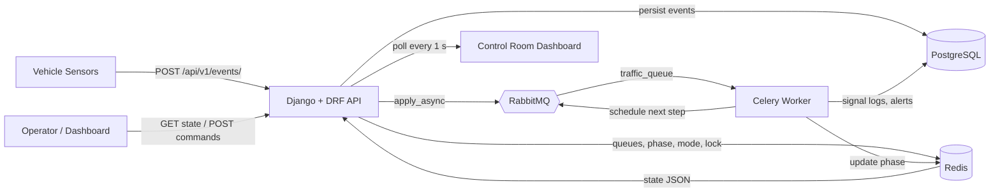
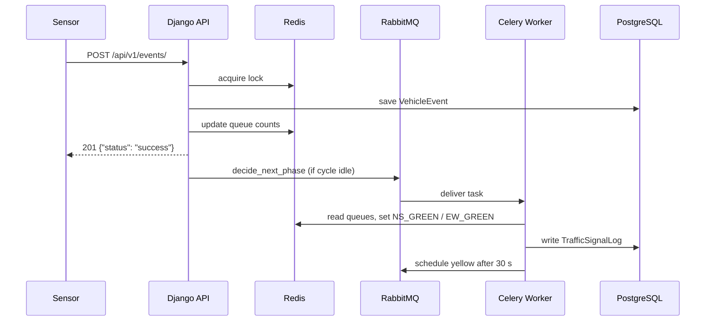
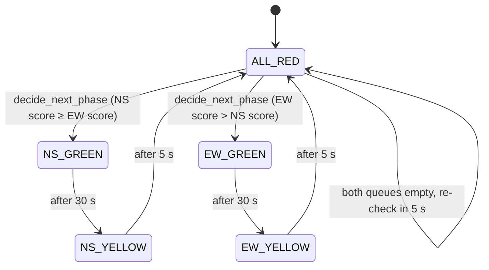

# 🚦 FTMS: Factory Traffic Management System

An event-driven, real-time traffic signal controller for factory and industrial junctions. Sensors report vehicles as they arrive and clear. The system keeps live queues, decides which direction gets the green light, handles emergency vehicle preemption, and shows everything on a live control-room dashboard.


---

## Table of Contents

1. [Features](#-features)
2. [Architecture](#-architecture)
3. [Signal Logic](#-signal-logic)
4. [Tech Stack](#-tech-stack)
5. [Project Structure](#-project-structure)
6. [Getting Started](#-getting-started)
7. [Configuration](#-configuration)
8. [API Reference](#-api-reference)
9. [Data Model](#-data-model)
10. [Dashboard](#-dashboard)
11. [Monitoring & Diagnostics](#-monitoring--diagnostics)
12. [Troubleshooting](#-troubleshooting)
13. [Security Notes](#-security-notes)
14. [Roadmap](#-roadmap)
15. [Contributing](#-contributing)
16. [License](#-license)

---

## ✨ Features

- **Event-driven ingestion**: sensors post `VEHICLE_ARRIVED` / `VEHICLE_CLEARED` events over a REST API.
- **Idempotent & safe**: duplicate events are ignored, and a Redis distributed lock prevents concurrent state corruption.
- **Live queue tracking**: per-direction vehicle counts held in Redis for sub-millisecond reads.
- **Automatic signal cycle**: queue-weighted decision engine runs as Celery tasks (`GREEN → YELLOW → ALL_RED → decide`).
- **Self-healing cycle**: a heartbeat key restarts the signal cycle automatically if it ever stops.
- **Emergency preemption**: an arriving emergency vehicle forces the junction into `EMERGENCY` mode, with a 5-minute safety timeout.
- **Manual override**: operators can request a green for a direction, then return to automatic mode.
- **Audit trail**: every signal change is stored in PostgreSQL (`TrafficSignalLog`), and system alerts in `SystemAlert`.
- **Real-time dashboard**: dark control-room UI that polls the state API every second.
- **Observability**: Flower, RabbitMQ management UI, and a built-in Celery health endpoint.
- **One-command deployment**: the whole stack runs with Docker Compose.

---

## 🏗 Architecture



### Request lifecycle



---

## 🧠 Signal Logic

### Phase state machine



### Timing

| Stage | Duration | Celery task |
|---|---|---|
| Green | 30 s | `start_green` |
| Yellow | 5 s | `transition_to_yellow` |
| All-red clearance | 2 s | `transition_to_all_red` |
| Idle re-check (empty queues) | 5 s | `decide_next_phase` |
| Emergency safety timeout | 300 s | `emergency_timeout_check` |

### Decision rule

```
NS score = queue[NORTH] + queue[SOUTH]
EW score = queue[EAST]  + queue[WEST]

both 0         → stay ALL_RED, re-check in 5 s
NS ≥ EW        → NS_GREEN
otherwise      → EW_GREEN
```

### Operating modes

| Mode | Behaviour |
|---|---|
| `AUTOMATIC` | Queue-weighted decisions drive the cycle. |
| `MANUAL` | Automatic decisions pause. The operator requests greens explicitly. |
| `EMERGENCY` | Set when an emergency vehicle arrives. The current green is cut to yellow immediately. After 5 minutes without a clear event, the junction reverts to `AUTOMATIC` and raises a `WARNING` alert. |
| `DEGRADED` | Reserved for hardware or heartbeat failures. |

### Safety guards

- **Stale-timer protection**: a delayed `transition_to_yellow` is ignored if the phase has already changed (for example after an emergency or manual override).
- **Self-healing**: every signal task refreshes a 90-second heartbeat key in Redis. If it expires, the next sensor event restarts the cycle.
- **Rollback on failure**: event persistence, queue update, and task scheduling run in one DB transaction. If any step fails, the event row is rolled back and the sensor can retry with the same `event_id`.

---

## 🧰 Tech Stack

| Layer | Technology |
|---|---|
| API | Django 4.2, Django REST Framework |
| Task queue | Celery 5 with RabbitMQ broker |
| Live state & locks | Redis 7 |
| Database | PostgreSQL 15 |
| Scheduler | `django-celery-beat` (DatabaseScheduler) |
| Task results | `django-celery-results` |
| Monitoring | Flower, RabbitMQ Management UI |
| Frontend | Vanilla HTML / CSS / JS |
| Packaging | Docker, Docker Compose, `uv` |
| Tunnel (optional) | ngrok |

---

## 📁 Project Structure

```
.
├── docker-compose.yml
├── Dockerfile
├── manage.py
├── .env.example
│
├── factory_core/                    # Django project
│   ├── __init__.py                  # loads the Celery app on startup
│   ├── celery.py                    # Celery app, queues, task routes
│   ├── settings.py
│   ├── urls.py
│   └── wsgi.py
│
├── traffic_control/                 # Main app
│   ├── models.py                    # Junction, VehicleEvent, TrafficSignalLog, ...
│   ├── views.py                     # REST endpoints
│   ├── urls.py
│   ├── tasks.py                     # Celery signal state machine
│   ├── core/
│   │   ├── state_manager.py         # Redis state, lock, heartbeat
│   │   └── queue_manager.py         # Queue counting and scoring
│   └── management/commands/
│       └── start_junction.py        # Create a junction and start its cycle
│
└── frontend/
    └── dashboard/
        └── dashboard.html           # Control-room UI
```

---

## 🚀 Getting Started

### Prerequisites

- Docker 24+ and Docker Compose v2
- (Optional) an [ngrok](https://ngrok.com) account, to expose the API to field sensors

### 1. Clone and configure

```bash
git clone https://github.com/<your-username>/<your-repo>.git
cd <your-repo>
cp .env.example .env
# edit .env and set strong passwords
```

### 2. Start the stack

```bash
docker compose up -d --build
```

### 3. Initialise the database

```bash
docker compose exec web python manage.py migrate
docker compose exec web python manage.py createsuperuser
```

### 4. Create a junction

```bash
docker compose exec web python manage.py start_junction --id A
```

This creates the `Junction` row, initialises its Redis state, and starts the signal cycle. Replace `A` with your own junction ID (maximum 10 characters).

### 5. Open the services

| Service | URL |
|---|---|
| Dashboard | http://localhost:8000/?junction=A |
| REST API | http://localhost:8000/api/v1/ |
| Django admin | http://localhost:8000/admin/ |
| Celery health | http://localhost:8000/api/v1/health/celery/ |
| Flower | http://localhost:5555 |
| RabbitMQ UI | http://localhost:15672 |
| ngrok inspector | http://localhost:4040 |

### 6. Send a test event

```bash
curl -X POST http://localhost:8000/api/v1/events/ \
  -H "Content-Type: application/json" \
  -d '{
    "event_id": "evt-0001",
    "junction_id": "A",
    "direction": "NORTH",
    "event_type": "VEHICLE_ARRIVED",
    "vehicle_type": "TRUCK",
    "sequence_no": 1,
    "timestamp": "2026-10-29T10:00:00Z"
  }'
```

Within a few seconds the dashboard should switch to **NS_GREEN**.

---


### Celery queues

| Queue | Purpose |
|---|---|
| `default` | General tasks |
| `traffic_queue` | All signal tasks (`start_green`, `transition_to_yellow`, `transition_to_all_red`, `decide_next_phase`, `emergency_timeout_check`) |

The worker runs with `--pool=solo --concurrency=1`, so signal transitions execute strictly one at a time.

### Redis keys

| Key | Purpose |
|---|---|
| `junction:{id}:state` | JSON state: phase, mode, queues |
| `junction:{id}:lock` | Distributed lock (5 s TTL) |
| `junction:{id}:cycle_alive` | Signal-cycle heartbeat (90 s TTL) |

---

## 📡 API Reference

**Base URL:** `http://localhost:8000/api/v1`
All request and response bodies are JSON.

### Enumerations

| Field | Allowed values |
|---|---|
| `direction` | `NORTH`, `SOUTH`, `EAST`, `WEST` |
| `event_type` | `VEHICLE_ARRIVED`, `VEHICLE_CLEARED` |
| `vehicle_type` | `EMERGENCY`, `TRUCK`, `FORKLIFT`, `EMPLOYEE_VEHICLE` |
| `phase` | `NS_GREEN`, `NS_YELLOW`, `EW_GREEN`, `EW_YELLOW`, `ALL_RED` |
| `mode` | `AUTOMATIC`, `MANUAL`, `EMERGENCY`, `DEGRADED` |

---

### 1. Submit a sensor event

`POST /api/v1/events/`

**Request body**

| Field | Type | Required | Notes |
|---|---|---|---|
| `event_id` | string (≤ 50) | yes | Unique per event. Used for deduplication. |
| `junction_id` | string | no | Defaults to `"A"`. |
| `direction` | enum | yes | See enumerations. |
| `event_type` | enum | yes | See enumerations. |
| `vehicle_type` | enum | no | Defaults to `EMPLOYEE_VEHICLE`. |
| `sequence_no` | integer | no | Defaults to `0`. |
| `timestamp` | ISO-8601 string | no | Defaults to server time. |

**Example request**

```json
{
  "event_id": "evt-0001",
  "junction_id": "A",
  "direction": "NORTH",
  "event_type": "VEHICLE_ARRIVED",
  "vehicle_type": "TRUCK",
  "sequence_no": 1,
  "timestamp": "2026-10-29T10:00:00Z"
}
```

**Responses**

`201 Created`
```json
{ "status": "success" }
```

`200 OK` (duplicate `event_id`)
```json
{ "message": "Duplicate event ignored" }
```

`400 Bad Request` (validation errors)
```json
{ "error": "Missing event_id" }
```
```json
{ "error": "Unknown junction" }
```
```json
{ "error": "Invalid direction. Use one of ['NORTH', 'SOUTH', 'EAST', 'WEST']" }
```
```json
{ "error": "Invalid timestamp format" }
```

`429 Too Many Requests` (junction is busy, retry)
```json
{ "error": "System is currently processing another event. Try again." }
```

**Emergency example**

```json
{
  "event_id": "evt-emg-0001",
  "junction_id": "A",
  "direction": "EAST",
  "event_type": "VEHICLE_ARRIVED",
  "vehicle_type": "EMERGENCY",
  "sequence_no": 2
}
```
This sets the mode to `EMERGENCY`, cuts the current green to yellow, and schedules a 5-minute safety timeout.

---

### 2. Get live junction state

`GET /api/v1/junctions/{junction_id}/state/`

**Response `200 OK`**

```json
{
  "phase": "NS_GREEN",
  "mode": "AUTOMATIC",
  "queues": {
    "NORTH": 6,
    "SOUTH": 5,
    "EAST": 0,
    "WEST": 0
  },
  "cycle_alive": true
}
```

| Field | Description |
|---|---|
| `phase` | Current signal phase. |
| `mode` | Current operating mode. |
| `queues` | Vehicles currently waiting per direction. |
| `cycle_alive` | `true` while the signal cycle heartbeat is fresh. |

If the junction has no stored state yet, the API returns defaults (`ALL_RED`, `AUTOMATIC`, empty queues).

---

### 3. Send a manual command

`POST /api/v1/junctions/{junction_id}/commands/`

#### Request a manual green

```json
{
  "command": "MANUAL_GREEN_REQUEST",
  "direction": "EAST"
}
```

`200 OK`
```json
{ "status": "Transitioning to Manual Green for EAST" }
```

If a green is currently active, the signal goes through the safe `YELLOW → ALL_RED` transition first, then grants the requested green.

#### Return to automatic mode

```json
{ "command": "RETURN_TO_AUTOMATIC" }
```

`200 OK`
```json
{ "status": "Returned to Automatic Mode" }
```

#### Error responses

`400 Bad Request`
```json
{ "error": "Command is required" }
```
```json
{ "error": "Invalid direction" }
```
```json
{ "error": "Unknown command: FOO" }
```

`429 Too Many Requests`
```json
{ "error": "System busy, try again" }
```

---

### 4. Celery health check

`GET /api/v1/health/celery/`

Verifies that the web process, broker, and worker are wired correctly.

**Response `200 OK`**

```json
{
  "celery_loaded_at_startup": true,
  "broker_url": "amqp://***@rabbitmq:5672//",
  "workers_ping": {
    "celery@worker-host": { "ok": "pong" }
  },
  "worker_queues": {
    "celery@worker-host": ["default", "traffic_queue"]
  },
  "registered_traffic_tasks": {
    "celery@worker-host": [
      "traffic_control.tasks.decide_next_phase",
      "traffic_control.tasks.emergency_timeout_check",
      "traffic_control.tasks.start_green",
      "traffic_control.tasks.transition_to_all_red",
      "traffic_control.tasks.transition_to_yellow"
    ]
  },
  "scheduled_eta_tasks": {
    "celery@worker-host": 1
  }
}
```

| Symptom in response | Meaning |
|---|---|
| `celery_loaded_at_startup: false` | `factory_core/__init__.py` does not import the Celery app. |
| `workers_ping: "NO WORKER REPLIED"` | The worker is down or connected to a different broker. |
| `traffic_queue` missing in `worker_queues` | The worker was started without `-Q default,traffic_queue`. |
| `registered_traffic_tasks` empty | Task import error. Check the worker logs. |
| `error` field present | Broker connection failure. |

---

### Quick reference

| Method | Endpoint | Purpose |
|---|---|---|
| `POST` | `/api/v1/events/` | Submit a sensor event |
| `GET` | `/api/v1/junctions/{id}/state/` | Live junction state |
| `POST` | `/api/v1/junctions/{id}/commands/` | Manual green / return to automatic |
| `GET` | `/api/v1/health/celery/` | Celery diagnostics |
| `GET` | `/` | Control-room dashboard |
| `GET` | `/admin/` | Django admin |

---

## 🗄 Data Model

| Model | Purpose | Key fields |
|---|---|---|
| `Junction` | A physical junction. | `id` (PK, ≤ 10 chars), `name`, `mode`, `last_heartbeat` |
| `VehicleEvent` | Raw sensor events (audit log). | `event_id` (unique), `direction`, `event_type`, `vehicle_type`, `sequence_no`, `sensor_timestamp`, `server_received_at`, `is_processed`, `error_message` |
| `TrafficSignalLog` | History of every signal phase. | `phase`, `triggered_by` (`AUTO_SCHEDULE`, `EMERGENCY_PREEMPTION`, `MANUAL_COMMAND`), `started_at`, `ended_at`, `duration_seconds` |
| `VehicleQueue` | Persistent per-direction queue snapshot. | `direction`, `vehicle_type`, `count`, `oldest_waiting_since` |
| `SystemAlert` | System and hardware alerts. | `severity` (`INFO`, `WARNING`, `CRITICAL`), `message`, `is_resolved` |

Live queue counts and the current phase are served from **Redis** for speed. PostgreSQL is the durable audit trail.

---

## 🖥 Dashboard

Open `http://localhost:8000/dashboard?junction=<JUNCTION_ID>`.

- Animated traffic lights for North/South and East/West.
- Live queue counters for all four directions.
- Mode badge (`AUTOMATIC` / `MANUAL` / `EMERGENCY`).
- Connection badge (Live / Offline) with an error banner.
- Signal cycle badge (Running / Idle).
- Junction switcher: change junction without reloading.
- Polls the state API every second.

---

## 🔍 Monitoring & Diagnostics

| Tool | What to look at |
|---|---|
| Worker logs | `docker compose logs -f celery_worker`. You should see `decide_next_phase → NS_GREEN → NS_YELLOW → ALL_RED` repeating. |
| Flower | Worker status and task history. Enable events first (see Troubleshooting). |
| RabbitMQ UI | Queue depth for `default` and `traffic_queue`. |
| `/api/v1/health/celery/` | End-to-end wiring check. |
| Django admin | Signal logs, alerts, and task results. |

Example healthy worker log:

```
[jts123] decide_next_phase NS=11 EW=0
Task traffic_control.tasks.decide_next_phase[...] succeeded in 0.04s
[jts123] NS_GREEN (AUTO_SCHEDULE)
Task traffic_control.tasks.start_green[...] succeeded in 0.05s
Task traffic_control.tasks.transition_to_yellow[...] received   # waits 30 s
```

---

## 🛠 Troubleshooting

**Dashboard is stuck on `ALL_RED`**
- Open `/api/v1/health/celery/` and check that a worker replied.
- Make sure the dashboard URL uses your real junction ID (`/?junction=<ID>`).
- Send at least one `VEHICLE_ARRIVED` event. With empty queues the junction correctly stays `ALL_RED`.

**No tasks appear in the worker log**
- Confirm `factory_core/__init__.py` contains `from .celery import app as celery_app`.
- Inside containers RabbitMQ is always on port `5672`. Check that `CELERY_BROKER_URL` uses `rabbitmq:5672`.
- Restart after code changes: `docker compose restart web celery_worker celery_beat`.

**Flower shows no tasks**
Enable task events in `settings.py`:
```python
CELERY_WORKER_SEND_TASK_EVENTS = True
CELERY_TASK_SEND_SENT_EVENT = True
```

**`429 System is currently processing another event`**
The junction lock is held (5-second TTL). Retry the request. The sensor client should implement retry with backoff.

**`400 Unknown junction`**
Create the junction first: `python manage.py start_junction --id <ID>`.

---

## 🔐 Security Notes

This project ships with development-friendly defaults. Before exposing it publicly:

- Set `DEBUG = False` and restrict `ALLOWED_HOSTS`.
- Load `SECRET_KEY` from the environment. Do not hard-code it.
- Protect `/api/v1/junctions/{id}/commands/` with authentication (JWT is already installed). Anyone who can reach it can control the signal.
- Authenticate sensors with an API key or mTLS.
- Never commit `.env`. Rotate any credential that has been shared publicly.
- Replace `runserver` with Gunicorn behind a reverse proxy for production.
- Disable the ngrok service outside of demos.

---

## 🗺 Roadmap

- [ ] Direction-aware emergency preemption (grant green to the emergency vehicle's approach).
- [ ] Anti-starvation: aging of long-waiting directions.
- [ ] Authentication and role-based access for manual commands.
- [ ] WebSocket / SSE push instead of 1-second polling.
- [ ] Multi-junction overview dashboard.
- [ ] Automated tests (unit and integration) and CI pipeline.
- [ ] Prometheus metrics and Grafana dashboards.
- [ ] Heartbeat monitoring that sets `DEGRADED` mode and raises `CRITICAL` alerts.

---

## 🤝 Contributing

1. Fork the repository.
2. Create a feature branch: `git checkout -b feature/my-feature`.
3. Commit your changes: `git commit -m "Add my feature"`.
4. Push the branch: `git push origin feature/my-feature`.
5. Open a Pull Request.

---

## 📄 License

See the [LICENSE](LICENSE) file for details.
